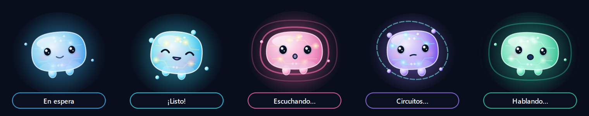
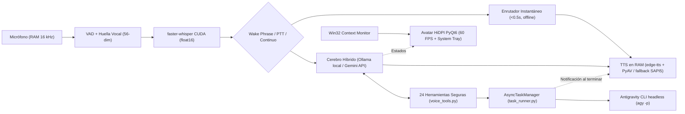

# Helena — Asistente Local de Ingeniería de Software para Windows 11

Asistente personal híbrido con **procesamiento de voz local acelerado por GPU (CUDA)**, **LLM local con tool-calling (Ollama)**, **avatar flotante animado en PyQt6 con conciencia de ventana activa (Win32)**, **servidor MCP personalizado**, **9 skills de desarrollo/automatización** y **delegación asíncrona a agentes de código (`agy` CLI)**.

Diseñado con foco en **privacidad (cero archivos de audio en disco)**, **baja latencia (<1 s en acciones locales)** y **seguridad por defecto** (lista blanca de herramientas y confirmación explícita para acciones destructivas).



---

## Arquitectura



## Capacidades principales

- **Voz 100% en RAM (privacidad real):** captura con `sounddevice`, transcripción en memoria con `faster-whisper` (CUDA `float16` o fallback automático a CPU `int8`), y síntesis neural `edge-tts` decodificada en memoria con `PyAV` (`io.BytesIO`) sin escribir `.wav` ni `.mp3` en disco (con fallback offline a Windows SAPI5).
- **Activación manos libres y entrenamiento con tu voz:** soporte para `"Oye Helena"` / `"Hola Helena"` (en modo 1 frase directa o 2 pasos), ventana de conversación continua (`6.5 s`), atajo global Win32 (`Ctrl+Alt+Espacio` / `Ctrl+Shift+H`) y perfil vocal local (`scripts/train_voice.py`, guarda solo vectores numéricos en `memory/voice_profile.pkl`).
- **Cerebro híbrido con 24 herramientas reales:**
  - **Ollama local** (modelo personalizado `Modelfile.helena` sobre `qwen2.5:7b` con `num_ctx=4096`) para respuestas rápidas offline y llamadas a herramientas locales.
  - **Delegación asíncrona de ingeniería:** `task_runner.py` delega tareas complejas multi-archivo a `agy -p --mode accept-edits` en segundo plano (sin ventanas negras con `CREATE_NO_WINDOW`) y notifica por voz al finalizar.
  - **Control seguro del PC y desarrollo:** crear/abrir carpetas y archivos, abrir proyectos en VS Code/Antigravity, correr chequeos (`manage.py check`, `pytest`, `tsc`), auditar git/secretos, inspeccionar puertos locales, probar APIs HTTP, controlar multimedia/volumen, YouTube/Google y memoria persistente.
- **Avatar flotante HiDPI con inteligencia contextual (`soul_avatar.py` + `context_monitor.py`):**
  - Renderizado vectorial anti-aliased en **PyQt6** (`WA_TranslucentBackground`, 60 FPS) con circuitos bioluminiscentes animados, física spring-damper y bandeja del sistema (`QSystemTrayIcon`).
  - Detecta tu ventana activa vía Win32: se **esconde automáticamente** en pantalla completa (videos/juegos) y reuniones (Zoom/Meet/Teams, pausando manos libres), y pasa a **modo discreto (38% opacidad en esquina)** cuando programas en VS Code/IDEs/terminal.
- **Ecosistema modular de desarrollo:**
  - **9 Skills** en `.agents/skills/` (`daily-briefing`, `pc-operator`, `dev-copilot`, `memory-manager`, `git-workflow`, `code-review-qa`, `api-db-inspector`, `automation-builder`, `career-docs-engineer`).
  - **Servidor MCP propio (`scripts/mcp_powershell.mjs`):** implementación JSON-RPC 2.0 sobre `stdio` en Node.js sin dependencias externas, con lista blanca de lectura y confirmación obligatoria para comandos riesgosos.
  - **Dashboard HUD interactivo (`dashboard.html`):** panel autocontenido en HTML/CSS/JS vanilla.

---

## Decisiones técnicas y trade-offs

| Decisión | Alternativa descartada | Por qué |
| :--- | :--- | :--- |
| **PyQt6 en hilo principal + señales thread-safe** | Tkinter en hilo secundario | Tkinter generaba `Tcl_AsyncDelete` en Windows y carecía de anti-aliasing y transparencia alfa por píxel. |
| **Audio 100% en RAM (`PyAV` + `sounddevice`)** | Archivos temporales `.wav`/`.mp3` + `pygame` | Garantiza cero audio residual en disco y reutiliza `av` (ya instalado por `faster-whisper`). |
| **Enrutado híbrido (Ollama 7B local + `agy` CLI)** | Todo en LLM local 7B o todo en nube | En 8 GB de VRAM un 7B es ideal para <1 s offline y tool-calling directo, mientras un agente frontier vía `agy` maneja refactors multi-archivo. |
| **Puerta VAD + Whisper CUDA para wake phrases** | Clasificador pequeño solo sobre `openwakeword` | Con GPU CUDA (~150 ms) permite múltiples frases en español (`Oye/Hola Helena`) y comandos en una sola frase sin falsos disparos en silencio. |
| **Voz nativa `es-US-PalomaNeural` por defecto** | Voces `*MultilingualNeural` | Las voces multilingües cambian de acento al leer términos técnicos en inglés; una voz nativa española mantiene consistencia (con cambio por voz a `Vivienne` si se desea). |

---

## Estructura del proyecto

```text
.
├── AGENTS.md                 # Reglas operativas, eficiencia y límites de seguridad
├── CONTEXT.md                # Mapa vivo del proyecto, decisiones y estado
├── CHANGELOG.md              # Historial de hitos técnicos
├── Modelfile.helena          # Definición del modelo Ollama personalizado
├── dashboard.html            # Panel visual HUD interactivo
├── Encender_Helena.bat       # Lanzador rápido en segundo plano (elimina HELENA_OFF)
├── requirements-voice.txt    # Dependencias Python (voz, PyQt6, CUDA opcional)
├── .env.example              # Plantilla de variables y rutas locales
├── .helena/                  # Índice de módulos (index.json) y lecciones (lessons.md)
├── .agents/skills/           # 9 skills enfocadas con scripts PowerShell (-Help)
├── memory/                   # Plantillas (*.example.md); los datos reales son gitignored
└── scripts/
    ├── voice_bridge.py       # Motor principal de voz, cerebro híbrido y TTS en RAM
    ├── voice_tools.py        # 24 herramientas seguras + enrutador instantáneo
    ├── task_runner.py        # Cola asíncrona de proyectos y delegación a Antigravity
    ├── soul_avatar.py        # Avatar flotante HiDPI PyQt6 (60 FPS + System Tray)
    ├── context_monitor.py    # Monitor Win32 de ventana activa (fullscreen/meeting/focus)
    ├── voice_profile.py      # Extracción de huella vocal (56-dim) en RAM
    ├── train_voice.py        # Asistente de calibración vocal (~60 s)
    ├── mcp_powershell.mjs    # Servidor MCP stdio seguro para PowerShell (Node.js)
    └── start_helena.ps1      # Arranque automático con Windows (respeta HELENA_OFF)
```

---

## Instalación rápida (Windows 11)

### Requisitos
- Windows 11, Python 3.12+, Node.js 20+, Git.
- *(Recomendado)* GPU NVIDIA con 6–8+ GB VRAM y [Ollama](https://ollama.com/) para inferencia 100% local.

### 1. Clonar y preparar entorno
```powershell
git clone https://github.com/PathFinder2408/Helena-IA-.git C:\Jarvis
cd C:\Jarvis
python -m venv .venv
.\.venv\Scripts\pip.exe install -r requirements-voice.txt
.\.venv\Scripts\pip.exe install openwakeword --no-deps
```

### 2. Configurar variables y memoria local
```powershell
Copy-Item .env.example .env
Copy-Item memory\context.example.md memory\context.md
Copy-Item memory\TODO.example.md memory\TODO.md
Copy-Item memory\inbox.example.md memory\inbox.md
```
Edita `.env` con tu `CITY`, tu carpeta de proyectos (`HELENA_PROJECTS_DIR`) y opcionalmente tu `GEMINI_API_KEY`.

### 3. Crear el modelo local en Ollama
```powershell
ollama pull qwen2.5:7b
ollama create helena -f Modelfile.helena
```

### 4. Verificar, entrenar tu voz y arrancar
```powershell
# Verificación completa (audio, Whisper, herramientas, TTS en RAM)
.\.venv\Scripts\python.exe scripts\voice_bridge.py --self-test --model small

# Calibrar ruido ambiente y tu huella vocal (~60 s, 0 audio en disco)
.\.venv\Scripts\python.exe scripts\train_voice.py

# Ejecutar Helena (avatar + voz)
.\.venv\Scripts\python.exe scripts\voice_bridge.py
```

### Arranque automático opcional (sin privilegios de administrador)
```powershell
$action = New-ScheduledTaskAction -Execute "powershell.exe" -Argument "-NoProfile -WindowStyle Hidden -ExecutionPolicy Bypass -File C:\Jarvis\scripts\start_helena.ps1 -NoIDE"
$trigger = New-ScheduledTaskTrigger -AtLogOn -User "$env:USERDOMAIN\$env:USERNAME"
$principal = New-ScheduledTaskPrincipal -UserId "$env:USERDOMAIN\$env:USERNAME" -LogonType Interactive -RunLevel Limited
Register-ScheduledTask -TaskName "Helena-Autostart" -Action $action -Trigger $trigger -Principal $principal -Force
```
Para pausar el arranque automático di **`"Helena, apágate"`** (crea `HELENA_OFF`); para reactivarla ejecuta `Encender_Helena.bat`.

---

## Seguridad y privacidad
- `.env`, registros (`logs/`), huellas vocales (`memory/voice_profile.pkl`) y archivos personales de `memory/` están excluidos en `.gitignore`.
- Ningún audio de entrada o salida se guarda en disco salvo que se pase explícitamente `--save-audio`.
- Las acciones destructivas (borrar archivos, `git push`, despliegues, comandos remotos) no están expuestas a ejecución automática por voz y requieren confirmación explícita.

## Licencia
[MIT](LICENSE)
